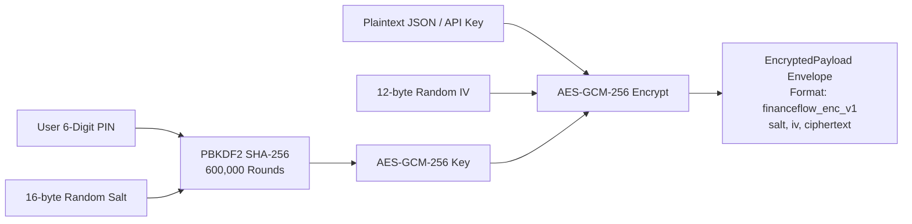
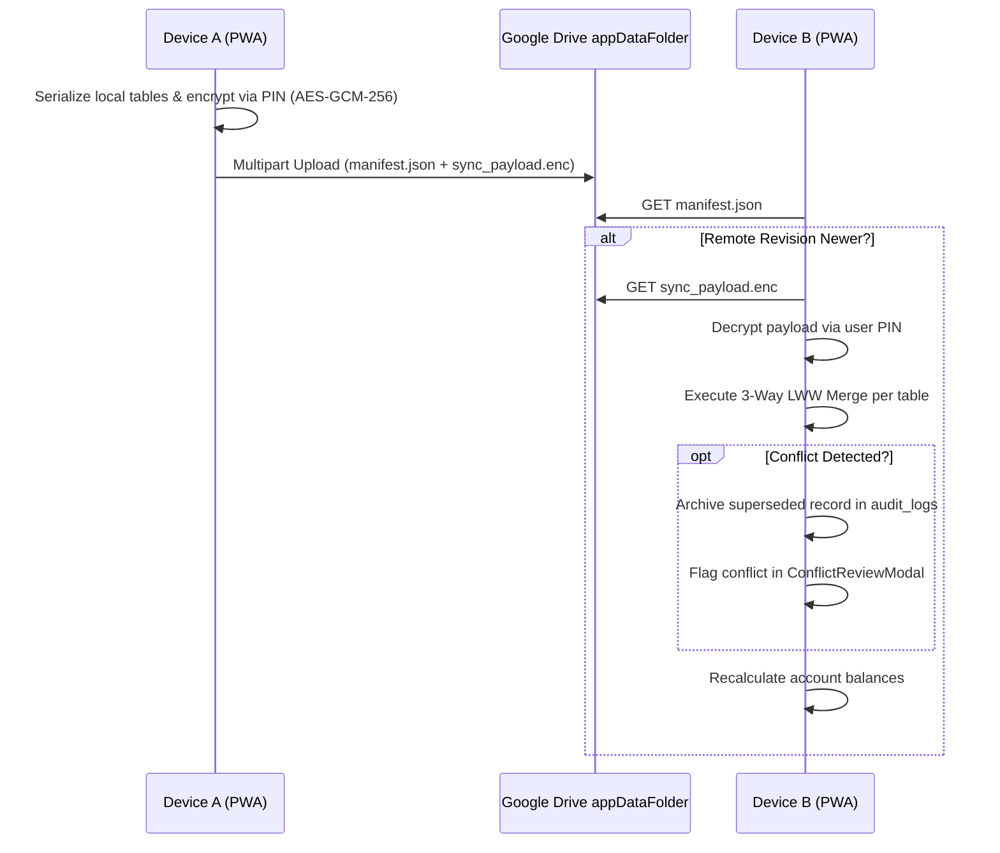
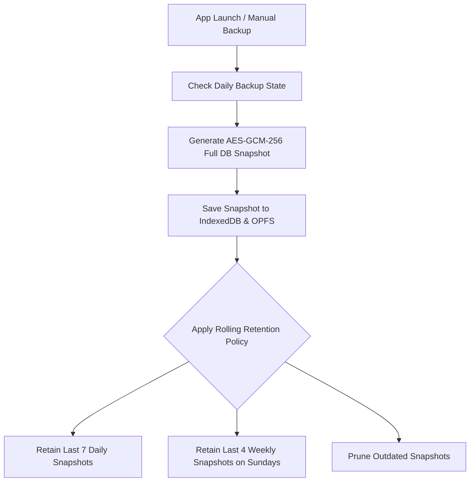
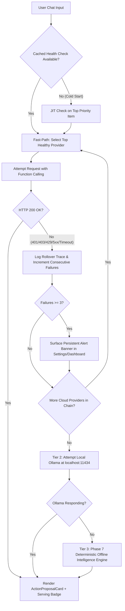
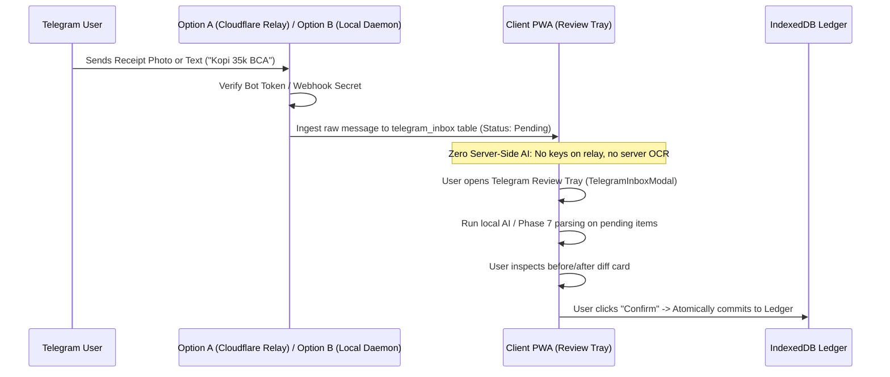
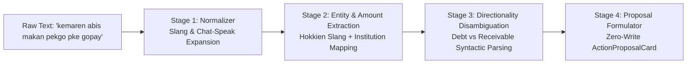
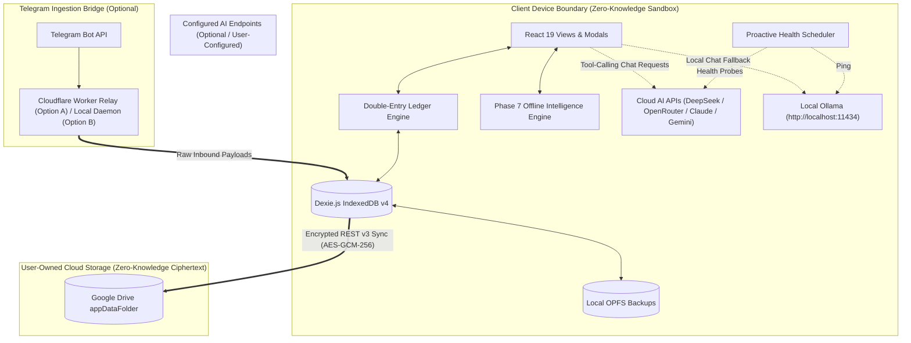

# FinanceFlow — System Architecture Specification

> **Target Version**: v0.1.0 (Phases 1 through 8 Verified)  
> **Classification**: Technical Architecture & Design Document  
> **Design Philosophy**: Client-Side-Only • Zero-Knowledge • Offline-First • Deterministic & Extensible

---

## Table of Contents

1. [Architectural Overview & Philosophy](#1-architectural-overview--philosophy)
2. [Data Model & Database Schema (Dexie Schema v4)](#2-data-model--database-schema-dexie-schema-v4)
3. [Cryptographic Security & Zero-Knowledge Architecture](#3-cryptographic-security--zero-knowledge-architecture)
4. [Sync & Conflict Resolution Engine](#4-sync--conflict-resolution-engine)
5. [Dual Backup Engine & Rolling Retention Policy](#5-dual-backup-engine--rolling-retention-policy)
6. [AI Copilot & Multi-Provider Fallback Architecture](#6-ai-copilot--multi-provider-fallback-architecture)
7. [Receipt OCR & Telegram Ingestion Pipelines](#7-receipt-ocr--telegram-ingestion-pipelines)
8. [Phase 7 Deterministic Offline Intelligence Engine](#8-phase-7-deterministic-offline-intelligence-engine)
9. [Bundle Performance & Code-Splitting Strategy](#9-bundle-performance--code-splitting-strategy)
10. [Consolidated System Diagrams](#10-consolidated-system-diagrams)

---

## 1. Architectural Overview & Philosophy

FinanceFlow is built entirely around the principle of **User Data Sovereignty**. In traditional web architectures, financial tracking applications host central databases, authenticate users through remote servers, and process data on backend compute instances. This creates security liabilities, cloud dependency, and privacy risks.

FinanceFlow adopts a decentralized, client-side-only architecture:

```
┌────────────────────────────────────────────────────────────────────────┐
│                        User Browser / Device PWA                       │
│                                                                        │
│  ┌──────────────────────┐   ┌───────────────────────────────────────┐  │
│  │   React 19 Views     │   │   Unified AI Chat & Visual Modals     │  │
│  │ Dashboard, Txs, Debt │   │ ActionProposalCard, OCR Scanner, etc. │  │
│  └──────────┬───────────┘   └───────────────────┬───────────────────┘  │
│             │                                   │                      │
│             ▼                                   ▼                      │
│  ┌──────────────────────────────────────────────────────────────────┐  │
│  │                  Domain Application Services                     │  │
│  │  Ledger, Debts, Recurring, Analytics, Telegram, AI Health, Sync  │  │
│  └──────────┬───────────────────────────────────┬───────────────────┘  │
│             │                                   │                      │
│             ▼                                   ▼                      │
│  ┌──────────────────────┐   ┌───────────────────────────────────────┐  │
│  │ Web Crypto Subtle    │   │  Dexie.js Reactive IndexedDB (v4)     │  │
│  │ PBKDF2 + AES-GCM-256 │   │ 15 Encrypted/Indexed Storage Tables   │  │
│  └──────────────────────┘   └───────────────────┬───────────────────┘  │
└─────────────────────────────────────────────────┼──────────────────────┘
                                                  │
                 ┌────────────────────────────────┴──────────────────┐
                 │ (Optional User-Configured External Integrations)  │
                 ▼                                                   ▼
┌─────────────────────────────────┐                 ┌─────────────────────────────────┐
│     Google Drive REST v3        │                 │  External AI Providers / Ollama │
│ Sandboxed appDataFolder Sync    │                 │ DeepSeek, OpenRouter, Claude,   │
│ (Authenticated Ciphertext Only) │                 │ Local Ollama (via user API key) │
└─────────────────────────────────┘                 └─────────────────────────────────┘
```

### Core Invariants:
1. **Zero-Knowledge Persistence**: User financial ledgers and third-party AI keys are stored locally in IndexedDB. API keys are encrypted at rest with AES-GCM-256 before disk writes.
2. **Network Decoupling**: The core double-entry ledger, recurring engine, analytics calculators, and Phase 7 intelligence engine execute 100% offline. Network requests occur exclusively when the user opts to fetch live FX rates, synchronize with Google Drive, or query an external AI provider.
3. **Zero-Write Confirmation Gate**: AI function calls and OCR receipt scans cannot write directly to IndexedDB. They generate structured proposals requiring explicit user verification before ledger commitment.

---

## 2. Data Model & Database Schema (Dexie Schema v4)

FinanceFlow utilizes [Dexie.js](https://dexie.org/) over browser IndexedDB. Schema migrations are managed through incremental Dexie versioning (currently at `version(4)`).

### Table Definitions

```typescript
this.version(4).stores({
  accounts: 'id, type, currency, isDeleted, updatedAt',
  categories: 'id, type, parentId, isSystem, isDeleted, updatedAt',
  transactions: 'id, type, date, timestamp, accountId, categoryId, currency, debtReceivableId, receiptHash, inputSource, isDeleted, updatedAt',
  debts_receivables: 'id, type, personName, status, dueDate, isDeleted, updatedAt',
  debt_payments: 'id, debtReceivableId, transactionId, isDeleted, createdAt',
  recurring_rules: 'id, nextExecutionDate, autoPost, isDeleted, updatedAt',
  audit_logs: 'id, entityType, entityId, action, timestamp, deviceId',
  fx_rates: 'id, fromCurrency, toCurrency, updatedAt',
  settings: 'id',
  local_backups: 'id, filename, dateStr, timestamp',
  telegram_inbox: 'id, updateId, timestamp, status',
  ai_providers: 'id, name, type, protocol, isEnabled, updatedAt',
  ai_keys: 'id, providerId, isActive, createdAt, updatedAt',
  ai_priorities: 'id, providerId, keyId, order, isEnabled',
  ai_failure_alerts: 'id, providerId, keyId, dismissed, timestamp',
});
```

### Table Field Specifications

#### `accounts`
Represents physical or digital asset containers (e.g. Bank BCA, Dompet Tunai, PayPal USD).
- `id` (string, UUIDv4): Primary key.
- `name` (string): Human-readable account name.
- `type` (`cash` | `bank` | `ewallet` | `paypal` | `investment` | `credit_card`).
- `currency` (CurrencyCode): ISO 4217 code (e.g. `'IDR'`, `'USD'`).
- `initialBalance` (number): Starting balance at account creation.
- `currentBalance` (number): Cached computed balance in account currency.
- `includeInNetWorth` (boolean): Flag to include or exclude from aggregate net worth.
- `monthlyAdminFee` (object, optional): Configuration for automated bank admin fees (`enabled`, `amount`, `dayOfMonth`, `categoryId`, `autoPost`).
- `isDeleted` (boolean): Soft-delete indicator.
- `updatedAt` (number): Epoch ms for Last-Write-Wins (LWW) conflict resolution.
- `version` (number): Incremental revision counter.

#### `categories`
Income and expenditure taxonomy.
- `id` (string): e.g. `'cat_food'`, `'cat_salary'`.
- `name` (string): e.g. "Food & Dining", "Transportation".
- `type` (`expense` | `income` | `both`).
- `parentId` (string, optional): Links subcategories to master categories.
- `isSystem` (boolean): Flags protected categories (e.g. Transfer, Debt/Loan, Bank Fees).
- `budgetMonthly` (number, optional): Monthly spending ceiling in user's base currency.
- `isDeleted`, `updatedAt`, `version`.

#### `transactions`
Double-entry immutable financial ledger records.
- `id` (string, UUIDv4): Primary key.
- `type` (`income` | `expense` | `transfer` | `debt` | `receivable`).
- `date` (string): Normalized `YYYY-MM-DD`.
- `timestamp` (number): Exact ms timestamp for chronological sorting.
- `amount` (number): Monetary value in transaction currency.
- `currency` (CurrencyCode): Currency of this transaction.
- `exchangeRateToBase` (number): Frozen conversion rate to user base currency at creation time.
- `baseAmount` (number): Amount normalized to base reporting currency (`amount * exchangeRateToBase`).
- `accountId` (string): Source account foreign key.
- `categoryId` (string): Category foreign key.
- `description` (string): Narration / merchant / notes.
- `transferMeta` (object, optional): Destination metadata for transfers (`toAccountId`, `toAmount`, `toCurrency`, `feeAmount`, `feeCategoryId`).
- `debtReceivableId` (string, optional): Foreign key linking to master debt/receivable.
- `receiptHash` (string, optional): SHA-256 hash of attached receipt image to detect duplicates.
- `inputSource` (`manual` | `ocr` | `telegram` | `voice` | `recurring` | `ai`).
- `isDeleted`, `updatedAt`, `version`.

#### `debts_receivables` & `debt_payments`
Tracks loan and borrowing lifecycles.
- `type` (`debt` = money I owe; `receivable` = money owed to me).
- `personName` (string): Counterparty identifier (e.g. "Budi", "Bank Mandiri").
- `originalAmount` (number): Initial principal.
- `currentBalance` (number): Outstanding unpaid balance.
- `status` (`open` | `partially_paid` | `settled`).
- `debt_payments` links specific settlement transactions to debt master records.

#### `ai_providers`, `ai_keys`, `ai_priorities`, `ai_failure_alerts`
Manages AI infrastructure and automatic rollover (Phase 8):
- `ai_providers`: Holds endpoint configurations for DeepSeek, OpenRouter, Gemini, Groq, Anthropic, OpenAI, Mistral, Ollama, and Custom endpoints.
- `ai_keys`: Stored independently from providers (one-to-many). Contains `encryptedKeyPayload` (AES-GCM-256 envelope), `keyHint` (`sk-...4f8b`), and `isActive`. Plaintext keys are never stored.
- `ai_priorities`: Ordered list (`order`, `providerId`, `keyId`, `modelOverride`, `isEnabled`) defining the failover hierarchy.
- `ai_failure_alerts`: Stores persistent alerts when a provider fails $\ge 3$ consecutive times.

---

## 3. Cryptographic Security & Zero-Knowledge Architecture

FinanceFlow relies on the browser's hardware-accelerated **Web Crypto API** (`window.crypto.subtle`) for all cryptographic operations.



### Authenticated Encryption Envelope (`financeflow_enc_v1`)
All encrypted artifacts (Google Drive sync backups, local export dumps, and stored AI API keys) adhere to a unified payload structure:

```typescript
export interface EncryptedPayload {
  format: 'financeflow_enc_v1';
  salt: string;       // Hex-encoded 16-byte cryptographic salt
  iv: string;         // Hex-encoded 12-byte initialization vector
  ciphertext: string; // Base64-encoded ciphertext + 128-bit GCM authentication tag
  timestamp: number;  // Epoch ms of encryption operation
}
```

### Key Derivation Parameters:
- **Algorithm**: PBKDF2 with SHA-256 hashing.
- **Iterations**: `600,000` rounds (exceeding OWASP and NIST SP 800-63B standards).
- **Cipher**: `AES-GCM` with a 256-bit key length and 128-bit authentication tag.
- **PIN Verification Canary**: To verify PIN correctness without storing PIN hashes, the system derives a key and attempts to decrypt an encrypted canary token (`{ canary: 'financeflow_valid_session' }`). Successful GCM tag verification confirms the user knows the PIN.

---

## 4. Sync & Conflict Resolution Engine

FinanceFlow synchronizes multi-device state via **Google Drive REST API v3**, operating entirely within the sandboxed `appDataFolder`.



### Conflict Resolution Invariant (Last-Write-Wins):
For each incoming remote record:
1. If record does not exist locally: insert into IndexedDB.
2. If record exists locally: compare `updatedAt` timestamps.
3. If `remote.updatedAt > local.updatedAt`: the remote record wins and overwrites the local entry.
4. If timestamps indicate concurrent modification: the superseded version is preserved in `audit_logs` with action `'conflict_superseded'`. The user can review and revert changes anytime via [`ConflictReviewModal.tsx`](file:///c:/Personal%20Finance/src/components/sync/ConflictReviewModal.tsx).

---

## 5. Dual Backup Engine & Rolling Retention Policy

FinanceFlow implements an automated dual backup system combining local Origin Private File System (OPFS) snapshots with Google Drive backups.



### Retention Rules:
- **Daily Window**: Retains all snapshots created within the last 7 calendar days.
- **Weekly Window**: For snapshots older than 7 days, retains one snapshot per week (specifically created on Sunday) up to 4 calendar weeks.
- **Pruning**: Snapshots that exceed both the 7-day daily window and the 4-week Sunday rule are automatically deleted to prevent storage unbounded growth.

---

## 6. AI Copilot & Multi-Provider Fallback Architecture

The conversational financial assistant is built around a **3-tier fallback architecture** that ensures users never experience an unhandled request failure:



### Internal App Tools Registry
The AI copilot communicates with the application through 8 internal functions:
1. `searchTransactions`: Query transaction records by keyword, account, date range, or amount.
2. `createTransactionProposal`: Formulate expense, income, or transfer proposals.
3. `editTransactionProposal`: Propose modifications to existing transactions.
4. `deleteTransactionProposal`: Propose soft-deletions with audit reasons.
5. `getFinancialSummary`: Retrieve cash flow totals and top spending categories.
6. `getBudgetStatus`: Inspect current month budget consumption and overrun states.
7. `getAccountsAndBalances`: Retrieve real-time account balances and currencies.
8. `getDebtsOverview`: Check outstanding debts and receivables.

---

## 7. Receipt OCR & Telegram Ingestion Pipelines

### Client-Side Lazy OCR Pipeline
1. **Dynamic Chunk Loading**: `tesseract.js` is isolated in a separate Rollup chunk (6.83 kB gzip). It is fetched on-demand only when the receipt modal is opened.
2. **Canvas Preprocessing**: The input image is drawn to an HTML5 offscreen canvas, transformed to grayscale, subjected to high-contrast thresholding ($Y = 0.299R + 0.587G + 0.114B$), and filtered to remove background noise.
3. **SHA-256 Deduplication**: A cryptographic hash of the raw image data is stored on the transaction (`receiptHash`). Scanning the same receipt twice triggers an immediate duplicate warning.

### Zero-Knowledge Telegram Ingestion Pipeline



---

## 8. Phase 7 Deterministic Offline Intelligence Engine

When offline, or when no AI provider keys are configured, FinanceFlow falls back to a deterministic 4-stage natural language pipeline that operates with **zero network dependencies and zero LLM calls**.



### Embedded Reference Lexicons:
- `INDONESIAN_MONETARY_SLANG`: Comprehensive Hokkien and regional numbers (`seceng` = 1,000, `goceng` = 5,000, `ceban` = 10,000, `noban` = 20,000, `nobango` = 25,000, `gocap` = 50,000, `cepek` / `cepek ceng` = 100,000, `pekgo` = 150,000, `gopek ceng` = 500,000, `sejt` / `sejuta` = 1,000,000).
- `INDONESIAN_CHAT_ABBREVIATIONS`: 1,500+ texting abbreviations (`byr`, `bl`, `trf`, `bwt`, `kmrn`, `blm`, `udh`, `smpe`, `pke`, `rek`, `ongkir`, etc.) and morphological affixes (`ng-`, `ny-`, `-in`).
- `FINANCIAL_INSTITUTIONS`: Keyword resolver for 20+ banks and digital wallets (BCA, Mandiri, BRI, BNI, GoPay, OVO, Dana, ShopeePay, PayPal).
- `Syntactic Disambiguation`: Resolves Indonesian lending vs borrowing directionality across reversed word orders (`aku pinjem budi 50k` $\to$ Debt; `budi pinjem aku 50k` $\to$ Receivable; `pinjemin budi 50k` $\to$ Receivable; `ditalangin budi 50k` $\to$ Debt).

---

## 9. Bundle Performance & Code-Splitting Strategy

FinanceFlow strictly enforces an initial page load budget of **$< 300\text{ kB}$ gzip**.

### Production Rollup Chunking Architecture
```typescript
// vite.config.ts manualChunks configuration
output: {
  manualChunks: {
    'vendor-react': ['react', 'react-dom'],
    'vendor-db': ['dexie', 'dexie-react-hooks'],
    'vendor-charts': ['chart.js', 'react-chartjs-2'],
  }
}
```

### Verified Build Metrics:
```
dist/index.html                          1.56 kB │ gzip:   0.74 kB
dist/assets/index-*.css                 44.13 kB │ gzip:   7.76 kB
dist/assets/vendor-react-*.js            4.21 kB │ gzip:   1.58 kB
dist/assets/vendor-db-*.js             106.37 kB │ gzip:  35.90 kB
dist/assets/vendor-charts-*.js         187.61 kB │ gzip:  65.56 kB
dist/assets/index-*.js (Main App)      558.17 kB │ gzip: 147.57 kB
─────────────────────────────────────────────────────────────────
Total Initial Page Load:               902.05 kB │ gzip: 259.11 kB (Budget: <300 kB)

On-Demand Lazy Loaded Chunks:
dist/assets/engine-*.js                 29.25 kB │ gzip:  10.24 kB (Offline Dictionaries)
dist/assets/index-*.js (OCR)            15.83 kB │ gzip:   6.83 kB (Tesseract OCR Engine)
```

$$\mathbf{259.11\text{ kB gzip Initial Load}} < \mathbf{300.00\text{ kB Budget}} \quad \checkmark \text{ PASSED (40.89 kB Headroom)}$$

---

## 10. Consolidated System Diagrams

### End-to-End System Topology & Security Boundary


