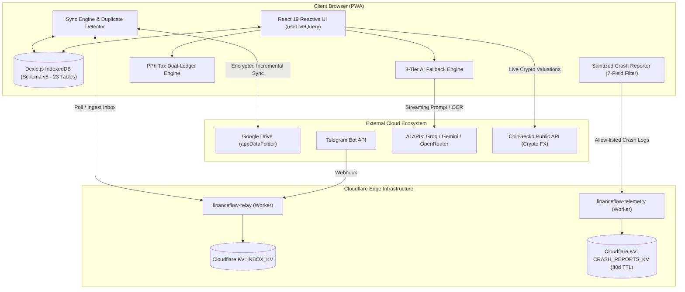
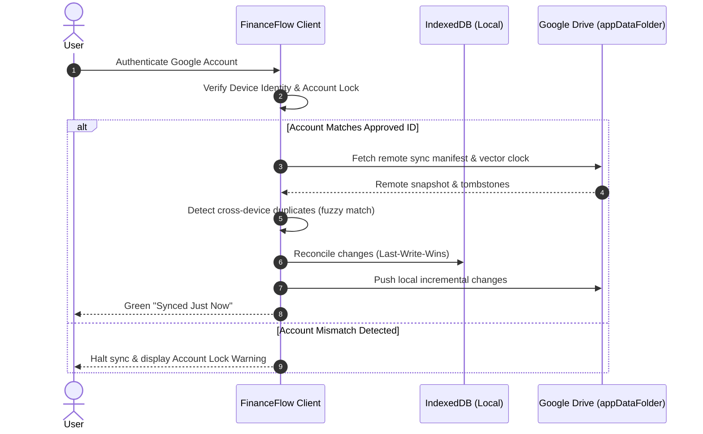
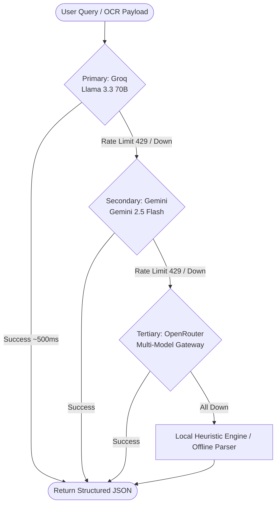

> [!NOTE]
> **Bilingual Documentation / Dokumentasi Dwibahasa**
> - Baca arsitektur sistem ini dalam **Bahasa Indonesia**: [ARCHITECTURE.id.md](file:///c:/Personal%20Finance/ARCHITECTURE.id.md)
> - Return to Main Documentation: [README.md](file:///c:/Personal%20Finance/README.md)

# FinanceFlow — System Architecture & Technical Specifications

This document outlines the software architecture, data models, synchronization protocols, edge infrastructure, and security boundaries implemented in FinanceFlow.

---

## 1. High-Level Architecture Overview

FinanceFlow follows an **Offline-First, Zero-Backend** architecture. The core application runs entirely within the user's web browser, maintaining a local-first source of truth in IndexedDB. External cloud services (Google Drive, Cloudflare Workers, AI APIs) act as auxiliary edge nodes rather than centralized databases.



---

## 2. Database Architecture (Dexie Schema v8)

FinanceFlow manages all local state via **Dexie.js 4.0** over IndexedDB. The database has evolved to **Schema Version 8**, containing **23 relational tables** with automatic versioned migrations preserving user data across upgrades.

### 2.1 Complete Table Schema & Index Map

| Table Name | Primary Key | Key Indexes & Multi-Entry Attributes | Purpose |
| :--- | :--- | :--- | :--- |
| `accounts` | `id` | `name, type, currency, isArchived, updatedAt` | Bank accounts, cash wallets, cards |
| `categories` | `id` | `name, type, isDefault, isArchived, updatedAt` | Spending & revenue category taxonomy |
| `transactions` | `id` | `accountId, categoryId, date, type, isTaxable, taxTreatment, syncStatus, isExcludedFromBudget, isRecurring, updatedAt` | Primary double-entry transaction ledger |
| `budgets` | `id` | `categoryId, month, period, updatedAt` | Category and period budget targets |
| `recurring_bills` | `id` | `accountId, categoryId, frequency, nextDueDate, isActive, updatedAt` | Subscriptions and regular recurring obligations |
| `debt_items` | `id` | `type, lenderOrBorrower, isSettled, dueDate, updatedAt` | Loans, debts owed, and receivables |
| `user_settings` | `key` | `updatedAt` | Client-side preferences, PIN hash, API keys |
| `sync_meta` | `id` | `key, updatedAt` | Vector clocks, last sync timestamps, tombstone logs |
| `monthly_snapshots` | `month` | `totalIncome, totalExpenses, netSavings, updatedAt` | Monthly historical performance rollups |
| `ai_rate_limits` | `id` | `provider, model, resetAt, updatedAt` | Rate-limiting metadata per AI vendor |
| `audit_log` | `id` | `entity, entityId, action, timestamp` | Tamper-evident local audit trail |
| `telegram_inbox` | `id` | `chatId, status, date, updatedAt` | Staged incoming transactions from Telegram |
| `receipt_scans` | `id` | `transactionId, status, scannedAt, updatedAt` | OCR processing records and extracted tokens |
| `fx_rates` | `currency` | `baseCurrency, date, updatedAt` | Foreign exchange rate conversion cache |
| `sync_duplicates` | `id` | `status, candidateCount, transactionIds, detectedAt, updatedAt` | Cross-device fuzzy match duplicate detection |
| `subscription_patterns`| `id` | `merchantName, estimatedAmount, frequency, status, updatedAt` | Inferred recurring subscription patterns |
| `ai_chat_sessions` | `id` | `title, updatedAt` | Conversation history for the AI Assistant |
| `receipt_attachments`| `id` | `transactionId, mimeType, createdAt` | Compressed raw receipt images (Base64/Blob) |
| `financial_goals` | `id` | `status, targetDate, linkedAccountId, updatedAt` | Savings targets with velocity projections |
| `investment_assets` | `id` | `type, symbol, currency, isArchived, updatedAt` | Stocks, crypto, gold, and property assets |
| `asset_valuations` | `id` | `assetId, date, updatedAt` | Valuation history logs per investment asset |
| `achievements` | `id` | `category, unlockedAt, updatedAt` | Gamification milestones and badge states |

---

## 3. Indonesian Personal Income Tax (PPh) Dual-Ledger Engine

The PPh Tax Estimator solves a fundamental challenge in personal finance: **separating taxable gross revenue from real cash flow**. 

When an affiliate marketer earns Rp 10,000,000 from Shopee, Shopee withholds PPh 21 (e.g., Rp 250,000) and transfers Rp 9,750,000 to the user's bank account. If only Rp 9,750,000 is logged, the tax calculation under-reports gross income. Conversely, if Rp 10,000,000 is logged to the bank account, the bank balance is artificially inflated by Rp 250,000.

### 3.1 Dual-Ledger Flow

```
[External Payer: Shopee / Employer]
       │
       ├── Gross Taxable Income: Rp 10,000,000 ────────┐ (Logged to Tax Subsystem)
       │                                               │
       ├── Bukti Potong (Tax Withheld): Rp 250,000 ────┼──> Tax Credit Offset
       │                                               │
       └── Net Cash Received: Rp 9,750,000             │
               │                                       │
               ▼                                       ▼
       [Bank Account Ledger]                [Annual Tax Calculator]
       (Balance: +Rp 9,750,000)             - Aggregates Annual Gross
                                            - Combines External Salary Baseline
                                            - Deducts Single PTKP (TK/0 - K/3)
                                            - Calculates PKP (Taxable Income)
                                            - Applies Progressive Brackets (5%-35%)
                                            - Subtracts Withholding Tax Credits
                                            - Outputs: Kurang / Lebih Bayar
```

### 3.2 Single-PTKP Rule Implementation
Under Indonesian tax law (UU HPP), PTKP (Penghasilan Tidak Kena Pajak) applies **once per individual per tax year**, combining both formal employment and side income. 

The engine implements this via an optional baseline field: `otherIncomeTaxAccounted` (employer salary).
1. $\text{Total Gross} = \sum(\text{Flagged Side Income Gross}) + \text{Employer Baseline Gross}$
2. $\text{Combined PKP} = \max(0, \text{Total Gross} - \text{PTKP})$
3. $\text{Gross Tax} = \text{CalculateProgressiveBrackets}(\text{Combined PKP})$
4. $\text{Tax Due} = \max(0, \text{Gross Tax} - \text{Tax Withheld Credits} - \text{Employer PPh 21 Paid})$

---

## 4. Cloud Sync & Multi-Device Security Protocol

FinanceFlow avoids central databases by synchronizing directly with the user's Google Drive via the private `appDataFolder` scope.



### 4.1 Security Boundaries
- **Single Approved Account Lock**: The first Google Account connected to an installation becomes the locked owner. Connecting a different Google account halts sync immediately to prevent accidental data mixing between different users.
- **Cross-Device Duplicate Engine**: Transactions created offline on two devices within a 60-minute window with identical amounts and matching categories are flagged in `sync_duplicates` for user review rather than blindly duplicated.
- **Tombstone Garbage Collection**: Deleted entities are marked with `isDeleted: true` and synced across nodes. Tombstones older than 90 days are purged during routine optimization.

---

## 5. Resilient 3-Tier AI Fallback Engine

The AI Assistant (`ai.ts`) coordinates intelligent parsing of receipts, chat commands, and voice transcriptions using a 3-tier cascade:



### Key AI Features:
- **Zero-Build-Time Secrets**: Keys are stored encrypted in the browser's IndexedDB, never embedded in source code or server environments.
- **Health Monitoring**: Proactive ping checks track provider latency, availability, and remaining rate limits.
- **Deterministic JSON Parsing**: Prompts strictly demand structured JSON output with schema validation before applying database writes.

---

## 6. Cloudflare Edge Workers & Zero-Knowledge Telemetry

### 6.1 `financeflow-relay` (Telegram Webhook Relay)
- Receives HTTP POST webhooks from Telegram Bot API.
- Buffers incoming messages and photo URLs in Cloudflare KV (`INBOX_KV`).
- Implements PIN-based payload encryption: only clients possessing the user's secret PIN can decipher and ingest the inbox queue.
- Zero credential logging: the worker never touches the user's AI keys or bank credentials.

### 6.2 `financeflow-telemetry` (Privacy-Preserving Crash Reporter)
- Opt-in error reporting allowing users to contribute diagnostic information.
- **Strict 7-Field Allow-List**: Rejects any request payload containing fields outside:
  `errorName`, `errorMessage`, `componentStack`, `url`, `userAgent`, `timestamp`, `version`.
- **Zero Financial Data Guarantee**: Transaction descriptions, account names, amounts, balances, and keys are mathematically excluded by schema validation.
- **Durable Persistence with Auto-TTL**: Stored in Cloudflare KV (`CRASH_REPORTS_KV`) with an automatic 30-day time-to-live (`expirationTtl: 2592000`).

---

## 7. Performance & Bundle Metrics

- **Initial Bundle Size**: ~320–330 kB gzip (including Chart.js, Lucide icons, and Dexie).
- **Time to Interactive (TTI)**: < 600ms on standard mobile networks.
- **Database Query Latency**: < 5ms for indexed queries using Dexie `useLiveQuery`.
- **Test Coverage**: 27 automated integration test suites executed in < 15 seconds.
