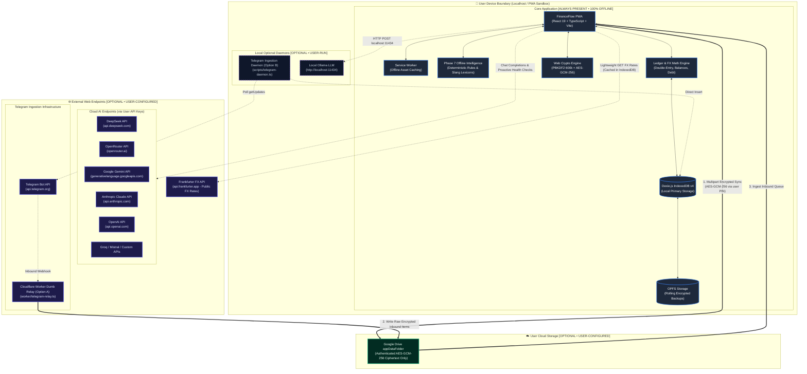

# FinanceFlow — Network & Execution Topology

> **Document Scope**: Infrastructure Topology, Component Distribution, Data Flow Matrix, and Connectivity Requirements.  
> **Target Audience**: System Architects, Developers, Security Auditors, and Advanced Users.

---

## 1. System Topology Map

The diagram below maps every component in the FinanceFlow ecosystem, detailing where code executes, where data persists, which external endpoints are invoked, and which components are **Core (Always Present)** versus **Optional (User-Configured)**.



---

## 2. Component Distribution & Execution Boundaries

| Component | Execution Location | Deployment Model | Persistence Layer | Privacy & Encryption Status |
|---|---|---|---|---|
| **FinanceFlow PWA** | Client Web Browser / Mobile Web View | Client-side static assets served via Service Worker | IndexedDB (`FinanceFlowDB` v4) | Zero plaintext transmitted over network. |
| **Double-Entry Ledger Engine** | Client Device CPU | In-memory TypeScript module | IndexedDB (`transactions`, `accounts`) | 100% Local. No server involved. |
| **Deterministic Offline Intelligence** | Client Device CPU | In-memory rule & regex engine (`src/services/offline`) | In-memory read-only lexicons | 100% Local. Zero network calls. |
| **Encrypted Dual Backup Engine** | Client Device CPU | In-memory Web Crypto pipeline | OPFS / IndexedDB (`local_backups`) | Encrypted at rest via AES-GCM-256. |
| **Google Drive Sync** | Client Device $\to$ Google Cloud | Direct REST v3 Multipart calls | Google Drive `appDataFolder` | **Zero-Knowledge**: Transmits strictly AES-GCM-256 ciphertext. |
| **Telegram Relay (Option A)** | Cloudflare Workers Edge | Serverless Worker ([`worker/telegram-relay.ts`](file:///c:/Personal%20Finance/worker/telegram-relay.ts)) | Google Drive Inbound Queue | Dumb relay. Holds **zero** user keys and performs **zero** OCR. |
| **Telegram Daemon (Option B)** | User Personal Computer / Server | Node.js process ([`scripts/telegram-daemon.ts`](file:///c:/Personal%20Finance/scripts/telegram-daemon.ts)) | Directly writes to local IndexedDB | 100% Local. No public open ports or webhooks. |
| **Cloud AI Providers** | Third-party Cloud (OpenRouter, DeepSeek, etc.) | External REST APIs | Transient request/response | Invoked only when user configures keys. Payload contains ledger context needed for query. |
| **Local Ollama LLM** | User Local Machine (`localhost:11434`) | Standalone local application | Local GPU/RAM | 100% Local. Data stays on machine. |
| **Frankfurter FX API** | European Central Bank data proxy | Public REST API (`api.frankfurter.app`) | Cached locally in IndexedDB (`fx_rates`) | Anonymous public read. No user data sent. |

---

## 3. Data Flow Matrix

The table below traces every data transmission pathway in the application:

| Flow # | Source | Destination | Protocol / Method | Data Transferred | Encryption & Protection | Online Required? |
|:---:|---|---|---|---|---|:---:|
| **1** | User Input | IndexedDB | Local JS Function Call | Ledger transactions, accounts, categories, debts | Local DB. Keys encrypted at rest via AES-GCM-256. | ❌ **No (100% Offline)** |
| **2** | PWA UI | Phase 7 Engine | Local Function Call | Raw text queries (Indonesian slang, queries) | Local RAM. Zero network traffic. | ❌ **No (100% Offline)** |
| **3** | PWA Storage | OPFS Storage | Web File System API | Full database snapshots (`.ffbackup`) | Encrypted with AES-GCM-256 + PBKDF2 (600k rounds). | ❌ **No (100% Offline)** |
| **4** | PWA | Google Drive | HTTPS REST v3 (`uploadType=multipart`) | `sync_manifest.json` and `sync_payload.enc` | **Authenticated Ciphertext**: AES-GCM-256. Zero plaintext. | 🌐 **Yes** |
| **5** | PWA | Frankfurter API | HTTPS GET (`api.frankfurter.app`) | Currency pairs (e.g. `USD`, `EUR`) | Public GET. No user data transmitted. Cached in IndexedDB. | 🌐 Optional (Fallback to cached) |
| **6** | PWA | Cloud AI Providers | HTTPS POST (`/chat/completions` or `/generateContent`) | User prompt + relevant transaction context for tool calling | User-supplied API key in auth header. TLS 1.3 in transit. | 🌐 Optional (User opted-in) |
| **7** | PWA | Local Ollama | HTTP POST (`http://localhost:11434/api/chat`) | User prompt + tool prompt structure | Local loopback interface (`127.0.0.1`). | ❌ **No (Local Network)** |
| **8** | Telegram Bot API | Cloudflare Worker (Option A) | HTTPS POST Webhook | Inbound message text or photo `file_id` | Webhook secret token verified via `X-Telegram-Bot-Api-Secret-Token`. | 🌐 **Yes** |
| **9** | Cloudflare Worker | Google Drive | HTTPS REST v3 | Raw queued inbound item JSON | Google Service Account OAuth token. | 🌐 **Yes** |
| **10** | Telegram Bot API | Local Daemon (Option B) | HTTPS Long-Polling (`getUpdates`) | Inbound message text or photo | Outbound polling from local machine. Zero incoming open ports. | 🌐 **Yes** |

---

## 4. Offline vs. Online Capabilities Breakdown

FinanceFlow is fundamentally an **offline-first application**. The matrix below clearly delineates what works without internet access versus what requires an active connection:

```
┌────────────────────────────────────────────────────────────────────────┐
│                        OFFLINE CAPABILITIES                            │
│                     (100% Functional with No Net)                      │
├────────────────────────────────────────────────────────────────────────┤
│  ✔  Full Ledger Entry, Editing, Deletion & Account Balancing           │
│  ✔  Multi-Currency Transactions (using cached exchange rates)           │
│  ✔  Debt & Receivable Tracking, Settlements & Installments             │
│  ✔  Recurring Rules Execution & Automated Bank Administration Fees     │
│  ✔  Analytics Dashboard, Cash Flow Bars, Donuts & Net Worth Curves     │
│  ✔  Month-End Burn Rate & Budget Overrun Projections                   │
│  ✔  Excel Workbook (.xml 3-sheet) & CSV Exports / Imports              │
│  ✔  PIN App Lock Screen & Biometric Authentication                     │
│  ✔  Automated Rolling Dual Backups to OPFS / IndexedDB                 │
│  ✔  Phase 7 Offline Intelligence: Indonesian Slang Numbers (pekgo,     │
│     gocap, ceban), Chat-Speak Normalization, Directionality Detection  │
│  ✔  Offline Transaction Search & Financial Summary Reporting           │
│  ✔  Offline Receipt Scanning (via cached Tesseract.js WASM)            │
│  ✔  Local Ollama LLM Queries (when running on localhost:11434)         │
└────────────────────────────────────────────────────────────────────────┘

┌────────────────────────────────────────────────────────────────────────┐
│                        ONLINE CAPABILITIES                             │
│                     (Requires Internet Connectivity)                   │
├────────────────────────────────────────────────────────────────────────┤
│  🌐  Real-Time FX Rate Sync from Frankfurter API (ECB Live Rates)      │
│  🌐  Google Drive Cloud Sync & Multi-Device LWW Replication            │
│  🌐  Inbound Telegram Message Fetching (via Relay or Polling Daemon)   │
│  🌐  Cloud AI Provider Chat & Tool Calling (DeepSeek, OpenRouter,      │
│      Gemini, Claude, OpenAI, Groq, Mistral)                            │
│  🌐  Live Dynamic Model Sync for Cloud AI Endpoints                    │
└────────────────────────────────────────────────────────────────────────┘
```

---

## 5. Security & Isolation Guarantees

1. **No Shared Central Database**: There is no "FinanceFlow Cloud". Each installation is an independent sovereign node.
2. **Untrusted Relays**: Even if an attacker compromises the Cloudflare Worker relay (Option A) or gains unauthorized access to your Google Drive account, they obtain **only authenticated ciphertext blobs** (`format: financeflow_enc_v1`). Without your 6-digit PBKDF2 PIN (600,000 iterations), brute-forcing the AES-GCM-256 key is computationally infeasible.
3. **Hard PIN Gating for AI Keys**: Stored AI API keys cannot be written to disk in plaintext. Entering an API key requires active PIN confirmation, encrypting the key before it touches persistent storage.
4. **Deterministic Failover Guarantee**: When internet connectivity drops, the proactive health scheduler automatically suppresses cloud pings and drops the AI pipeline straight to the Phase 7 Deterministic Offline Intelligence Engine. The user is never blocked from logging their finances.
